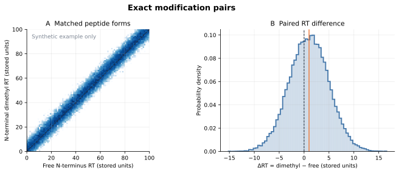
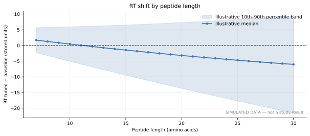

# DIA-NN Speclib Explorer

Python tools for reading precursor entries and retention times (RTs) from
DIA-NN compact `.speclib` files, exporting library tables to Parquet, and
comparing predicted RTs across libraries and modification groups. The tools
run locally and do not require DIA-NN.

There are two main workflows:

1. **Parse/translate a `.speclib`** into tables for precursors, fragments, and
   proteins, or extract just peptide-form RTs for compact downstream analysis.
2. **Compare and plot libraries**, including paired RT changes and exact
   N-terminal dimethylation comparisons.

## Thesis context

This tool was developed for spectral-library RT comparisons alongside the
[HUNTER DIA model-adaptation thesis](https://github.com/mmmddd98/hunter-dia-model-adaptation).
The thesis describes extraction of precursor entries and RTs, RT-distribution
comparisons across libraries and modification groups, and paired comparisons
of shared peptidoforms. For these RT comparisons, charge states are grouped
by modified peptide sequence; the extractor checks that their RTs agree and
keeps its marker-derived decoy groups separate.

The current package also provides CARAFE import and additional plotting
commands, documented below. These capabilities do not imply that every
analysis shown here was reported in the thesis.

The example figures below use simulated peptide data to demonstrate the plot
styles; they are not results from a particular study.





## Supported files

The binary parser supports the compact DIA-NN `.speclib` layouts with format
version `-10` and `-11` that have been inspected so far. A `.skyline.speclib`
file is a Skyline sidecar, not a standalone compact library; the parser detects
and rejects that format with an explanation. Support for additional layouts
has not yet been verified.

## Decoy status and interpretation

The tools **do not remove decoys** from DIA-NN or CARAFE libraries. DIA-NN
peptidoforms are retained regardless of the parser's marker-derived `decoy`
flag. For completed CARAFE libraries, rows with both `Decoy = 0` and
`Decoy = 1` are retained and kept distinct during RT aggregation. The flag is
metadata for grouping and plotting, not an independent FASTA validation.
Chunk-only CARAFE inputs do not provide the same decoy annotation, so their
decoy status cannot be established from those files; rows are still retained.

Older CARAFE tables generated by versions of the importer that kept only
`Decoy = 0` must be regenerated before comparing them as unfiltered libraries.
The current importer records its decoy handling in the manifest. No result
should be described as decoy-free based on this tool; a FASTA audit would
require the exact target/decoy FASTA and its protein-label convention, and this
package does not perform that audit.

Counts in plots and summaries refer to extracted forms or matched pairs in the
output tables. They are not total precursor counts from the original libraries
and are not verified counts of biological target peptides.

## Install

Requires Python 3.10 or newer. From a clone of this repository:

```bash
python -m venv .venv
source .venv/bin/activate
python -m pip install --upgrade pip
python -m pip install .
```

To install from GitHub without cloning first:

```bash
python -m pip install "git+https://github.com/mmmddd98/diann-speclib-explorer.git"
```

Check the command-line interface:

```bash
diann-speclib --help
```

You can also run it as `python -m diann_speclib_explorer`.

## Workflow A: parse a complete library

The general parser streams records and writes three Zstandard-compressed
Parquet files plus a metadata JSON file:

```bash
diann-speclib parse /path/to/library.predicted.speclib \
  --out-dir ./parsed-library
```

`parsed-library/` contains:

- `precursors.parquet`: sequence, charge, precursor m/z, RT, ion mobility,
  fragment count, and raw numeric fields whose semantics are not yet known.
- `fragments.parquet`: fragment m/z, relative intensity, charge, ion type,
  series number, and loss code, linked by `precursor_id`.
- `proteins.parquet`: protein identifiers and names, gene names, and raw
  metadata words.
- `parse_metadata.json`: detected format, counts, offsets, and input metadata.

For a quick format check, parse a prefix of complete precursor records:

```bash
diann-speclib parse /path/to/library.predicted.speclib \
  --out-dir ./parsed-prefix \
  --max-precursors 1000 \
  --batch-precursors 1000 \
  --batch-fragments 50000
```

`--max-precursors` limits the number of records exported after the parser finds
the first record. Finding that first record may require scanning a large gap
after the protein table, especially in large files. The parser does not load
the complete library into RAM, but it does read the source file during that
scan. `--scan-limit-mb` can cap the scan if you want a bounded trial.

## Workflow B: extract RTs and create plots

For RT comparisons, the compact extractor skips fragment decoding and stores
only one RT per modified peptide form. It collapses charge states after
checking that their RTs agree. It also stores the marker-derived decoy flag and
separate UniMod:510 and UniMod:255 presence and N-terminal/lysine site flags
for grouping and plots. Decoys are retained; see
[Decoy status and interpretation](#decoy-status-and-interpretation). These
modification identifiers are kept distinct: UniMod:510 is a heavy dimethyl
label, while UniMod:255 is the separate Acetald+28 modification.

```bash
diann-speclib extract-rt \
  --out-dir ./rt-comparison \
  --library baseline=/path/to/baseline.predicted.speclib \
  --library tuned_rt=/path/to/tuned.predicted.speclib \
  --library tuned_rt_fr=/path/to/tuned-fragment.predicted.speclib \
  --jobs 2 \
  --cpus 2 \
  --max-ram-mb 2048
```

Library labels must be unique. Each one is written to
`rt-comparison/data/library=<label>/rt.parquet`. The output folder also keeps
the run manifest, progress snapshots, and logs. The RAM option is a soft guard
checked between batches, not an operating-system memory limit. `--cpus` limits
CPU affinity where supported; `--jobs` sets how many libraries can run at
once. To parallelize one large file, set `--chunks-per-library` and allow
enough CPUs. A short trial can use `--max-peptidoforms 100000`.

Create paired RT plots from the extracted tables:

```bash
diann-speclib-plot-rt \
  --extracted-dir ./rt-comparison/data \
  --out-dir ./rt-comparison/analysis
```

This joins on `(modified_sequence, decoy)`, not row order, and limits
like-for-like plots to forms shared by all supplied libraries. It writes
publication-quality PNG, PDF, and SVG figures, a paired Parquet table, and
JSON/CSV summaries. DIA-NN decoy status is not independently verified, so
shared forms and reported counts may include decoy-derived sequences.

Create the modification-focused figures after the RT comparison step:

```bash
diann-speclib-plot-modifications \
  --extracted-dir ./rt-comparison/data \
  --out-dir ./rt-comparison/analysis/modification_pairs
```

The command finds exact pairs that differ only by a leading N-terminal
UniMod:510. All other sequence modifications and extracted decoy flags must
match. The flags are not FASTA-validated, so exact pairs can include
decoy-derived sequences. The command also writes RT densities for dimethylated
forms and additional views of RT changes by modification site, RT range, and
peptide length. By default it uses
`./rt-comparison/analysis/paired_rt_common.parquet`, created by the previous
plotting command. Supply `--common-forms` to use a different shared table.

The paired method avoids comparing different peptide sequences as if they
were a modification pair. It does not imply that a predicted RT change is a
measured chromatographic effect. RTs are plotted in the stored DIA-NN units;
the file does not provide a universal minute conversion.

### Compare integrated RT and RT+fragment tuning runs

For experiments with DIA-NN `final_report.parquet` outputs for balanced, fast,
and slow quantification, compare the report's observed `RT` with `Predicted.RT`
for the RT-only and RT+fragment (RT+FR) libraries:

```bash
diann-speclib-plot-integrated-tuning \
  --quant-dir /path/to/05_quant/tuned \
  --out-dir ./integrated-tuning-analysis
```

The analysis uses the six report files named `balanced_rt_lr_0p00011_d0`,
`balanced_rt_fr_lr_0p00011_d0`, and their `fast_` and `slow_` counterparts.
It collapses precursor-charge rows by median to one row per run, modified
sequence, and DIA-NN `Decoy` flag. It retains both decoy-flag states and shows
them separately without FASTA validation. It applies no q-value filter and
reports observed-minus-predicted RT errors in the units stored by DIA-NN.
The summary counts describe final-report observations, not total library
candidates or verified targets.

This compares quantification outcomes as well as the RT predictions used by
them. Check the `--lib` paths in each run's `startcmd.txt`: fast, balanced, and
slow runs can reuse the same underlying RT or RT+FR predicted library. They
are then different RT-window settings, not six independent RT predictors. In
the example outputs, balanced uses DIA-NN's default RT window, fast uses
`--rt-window-mul 1.7 --rt-window-factor 100`, and slow uses `--no-rt-window`.

### Add CARAFE predictions and compare a larger collection

If CARAFE output is available, import it into the same RT dataset. The importer
uses the final `carafe_spectral_library.diann2.parquet` when present, reads only
its peptide key, decoy flag, precursor m/z, and RT columns, and streams the
fragment rows. Incomplete chunk-only runs are skipped by default. Pass
`--include-partial` to opt in to importing them as clearly marked partial
datasets. Chunk imports map CARAFE modifications to DIA-NN `Modified.Sequence`
keys.

```bash
diann-speclib-import-carafe-rt \
  --out-dir ./rt-comparison \
  --library carafe_baseline=/path/to/carafe_baseline_run \
  --library carafe_external=/path/to/carafe_external_run \
  --cpus 4 \
  --batch-size 500000 \
  --max-ram-mb 128000
```

Add `--include-partial` only when you explicitly want results from incomplete
CARAFE runs.

Compare all imported libraries against the original DIA-NN baseline by exact
sequence and extracted decoy flag. The script samples baseline forms reproducibly and compares
within-library RT percentiles, so DIA-NN and CARAFE values with different raw
scales are not mixed. Incomplete CARAFE runs are excluded by default; if you
explicitly import one with `--include-partial`, it is marked as partial.

```bash
diann-speclib-plot-all-rt \
  --out-dir ./rt-comparison \
  --sample-size 1000000 \
  --cpus 4
```

This writes matched RT percentile panels, a UniMod:510-only panel, a
library-coverage plot, a UniMod:510-stratified rank-shift plot, a separate
within-library RT distribution for `baseline_mod255` when present, a CSV with
coverage/count/statistic summaries, and JSON provenance. Exact matches to the
primary `baseline` use the full modified sequence and decoy flag as their key.
Coverage counts are extracted forms, not verified target counts; see
[Decoy status and interpretation](#decoy-status-and-interpretation). The mod-255
distribution is shown separately because UniMod:255 and UniMod:510 are
different modification identifiers. For
completed CARAFE runs, one RT per sequence/decoy form is the median over distinct
precursor m/z variants because CARAFE can have different values for the same
peptide sequence at different precursor masses. Incomplete runs use the median
normalized `rt_norm_pred` over their available precursor m/z values. Do not
compare these raw values directly with DIA-NN's stored `rt`; the all-library
plot compares within-library percentile ranks.

## Reproducible comparisons

An exact K-dimethylated versus K-unmodified comparison requires both K states
for the same peptide sequence and the same other modifications. If all
K-containing candidates in the supplied libraries are K-dimethylated, there
is no such matched comparison to plot. The scripts report this instead of
silently treating unrelated peptides as pairs.

For a different experiment, keep its extracted data and figures in its own
output directory and pass those paths explicitly. Do not commit spectral
libraries, Parquet results, logs containing sensitive paths, or unpublished
study data to this repository.

## Development

```bash
python -m pip install -e '.[dev]'
python -m pytest
```

See [CONTRIBUTING.md](CONTRIBUTING.md) for contribution notes. The package is
distributed under the MIT License; see [LICENSE](LICENSE).
